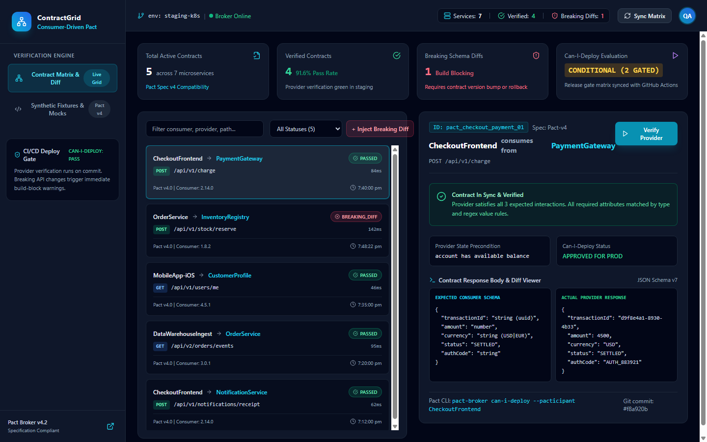
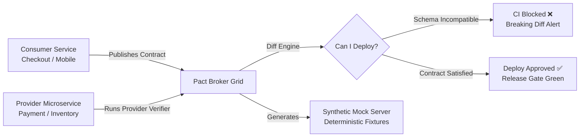

# Consumer-Driven Contract Testing Grid (Pact v4)

[]()
[]()
[]()
[]()

> Enterprise consumer-driven contract testing broker and verification grid. Validates cross-service schemas between frontends, microservices, and event streams, flags breaking field mutations before deployment, and provides deterministic synthetic mock fixtures.

---

## 📸 Platform Dashboard



---

## ⚡ Core Capabilities

- **Consumer-Driven Pact Specification (v4.0):** Standardizes contract definition across consumer repos; microservices only ship when provider verification passes.
- **Breaking Schema Diff Inspector:** Side-by-side JSON Schema v7 diff viewer identifying dropped keys, changed primitive types, and missing nullability flags.
- **Can-I-Deploy CI/CD Gating:** Automated decision matrix integrated into pull requests to prevent incompatible producer/consumer code merges.
- **Synthetic Fixture Engine:** Generates deterministic JSON mocks matching contract regex and type matchers for fast local unit testing without upstream services.

---

## 🏗️ Architecture & Verification Flow



---

## 📊 Dataset Benchmark Reference

Bundled benchmark dataset located at `data/kaggle_contract_testing_pact_benchmark.csv`:

| Contract ID | Consumer | Provider | Endpoint | Method | Status | Latency |
| :--- | :--- | :--- | :--- | :--- | :--- | :--- |
| `pact_checkout_payment_01` | CheckoutFrontend | PaymentGateway | `/api/v1/charge` | `POST` | `PASSED` | 84ms |
| `pact_orders_inventory_02` | OrderService | InventoryRegistry | `/api/v1/stock/reserve` | `POST` | `BREAKING_DIFF` | 142ms |
| `pact_mobile_customer_03` | MobileApp-iOS | CustomerProfile | `/api/v1/users/me` | `GET` | `PASSED` | 46ms |
| `pact_analytics_orders_04` | DataWarehouseIngest | OrderService | `/api/v2/orders/events` | `GET` | `PASSED` | 95ms |
| `pact_checkout_notification_05` | CheckoutFrontend | NotificationService | `/api/v1/notifications/receipt` | `POST` | `PASSED` | 62ms |

---

## 🚀 Quickstart Guide

### Option 1: Docker Compose (Production Setup)

```bash
git clone https://github.com/Prasunnandi/consumer-contract-testing-grid.git
cd consumer-contract-testing-grid
docker-compose up --build
```
- Web Dashboard: `http://localhost:3000`
- REST & Pact Broker API: `http://localhost:8000`

### Option 2: Local Development

```bash
# 1. Start Backend API
cd backend
npm install
npm run dev

# 2. Start React Frontend
cd ../frontend
npm install
npm run dev
```

---

## 🛠️ API Reference

- `GET /api/contracts` - Returns all registered Pact contracts and verification statuses.
- `GET /api/contracts/:id` - Detailed interaction body and JSON schema diff.
- `POST /api/contracts/:id/verify` - Triggers real-time provider replay verification.
- `GET /api/can-i-deploy` - Returns overall deployment eligibility and gating matrix.

---

## 📄 License

MIT © [Prasun Nandi](https://github.com/Prasunnandi)
